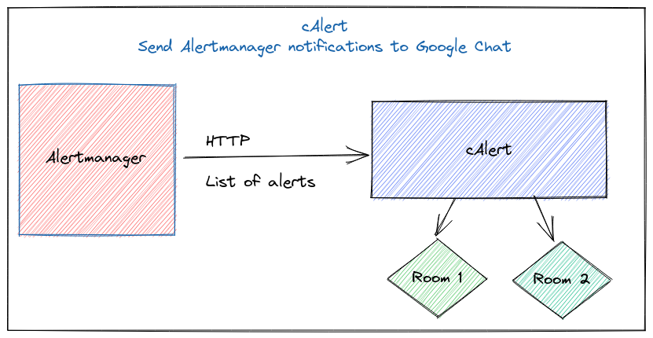

<a href="https://zerodha.tech"></a>

# calert

_Send Alertmanager notifications to Google Chat (and more!)_



`calert` receives webhooks from Prometheus [Alertmanager](https://prometheus.io/docs/alerting/latest/configuration/#webhook_config) and delivers formatted notifications to [Google Chat webhooks](https://developers.google.com/workspace/chat/quickstart/webhooks).

- **Flexible threading:** Deterministic per-alert threads (`alert` mode) or aggregated per-group threads (`group` mode) with opt-in TTL and incident-based thread rotation.
- **Active-active ready:** Optional Redis-backed state sharing for group deduplication and thread rotation across replicas.
- **Rich formatting:** Go templates with helper functions and Google Chat CardsV2 support, including bundled text and card templates.
- **Observable & lightweight:** Built-in Prometheus `/metrics`, `/ping` health check, Ubuntu and `scratch` container images, and an official Helm chart.

## Quickstart

### Binary

Download the latest release from [Releases](https://github.com/mr-karan/calert/releases), copy [config.sample.toml](config.sample.toml) to `config.toml`, and run:

```sh
./calert.bin --config config.toml
```

### Docker

Multi-arch images (`linux/amd64`, `linux/arm64`) are published to [GitHub Container Registry](https://github.com/mr-karan/calert/pkgs/container/calert):

```sh
docker pull ghcr.io/mr-karan/calert:latest
```

- `latest` (default): Built on **Ubuntu 26.04** with a shell, CA certificates, and timezone data for production debugging.
- `latest-scratch`: Minimal `scratch` image containing the same static binary, CA certificates, and timezone data, without a shell or package tools.

#### Custom Configuration & Message Template

Mount your `config.toml` (and optional custom template) into the container and pass `--config`:

```yml
services:
  calert:
    image: ghcr.io/mr-karan/calert:latest
    command: ["--config", "/app/config.toml"]
    ports:
      - "6000:6000"
    volumes:
      - ./config.toml:/app/config.toml:ro
      - ./message.tmpl:/etc/calert/message.tmpl:ro # optional: set template = "/etc/calert/message.tmpl" in config.toml
```

### Helm

Deploy on Kubernetes using the official Helm chart in [contrib/helm/calert](contrib/helm/calert/README.md):

```sh
helm repo add calert https://mr-karan.github.io/calert/charts
helm repo update
helm install calert calert/calert -f values.yaml
```

## Configuration

Refer to [config.sample.toml](config.sample.toml) for a complete example configuration.

Every configuration key can also be set via environment variables by prefixing `CALERT_` and replacing `.` with `__` (double underscores):

- `app.address` → `CALERT_APP__ADDRESS`
- `providers.prod_alerts.endpoint` → `CALERT_PROVIDERS__PROD_ALERTS__ENDPOINT`
- `providers.prod_alerts.redis.password` → `CALERT_PROVIDERS__PROD_ALERTS__REDIS__PASSWORD`

### App

| Key | Description | Sample Default |
|---|---|---|
| `app.address` | Address for the HTTP server to listen on. | `0.0.0.0:6000` |
| `app.server_timeout` | HTTP read/write timeout (also bounds per-request dispatch timeout). | `60s` |
| `app.enable_request_logs` | Enable HTTP request logging. | `true` |
| `app.log` | Log level (`info` or `debug`). | `info` |

### Providers

`calert` loads a map of _providers_ keyed by room name (`providers.<room_name>`). Each provider has its own configuration based on its `type`. Currently `google_chat` is supported, and the provider interface allows adding arbitrary providers.

| Key | Description | Required | Default |
|---|---|---|---|
| `providers.<room_name>.type` | Provider type. Currently only `google_chat` is supported. | no | `google_chat` |
| `providers.<room_name>.endpoint` | Google Chat webhook URL to send alerts to. | **yes** | - |
| `providers.<room_name>.max_idle_conns` | Maximum keep-alive connections to keep in the HTTP pool. | no | `50` |
| `providers.<room_name>.timeout` | Timeout for HTTP requests to the provider webhook URL. | no | `30s` |
| `providers.<room_name>.proxy_url` | Optional HTTP proxy URL for outbound provider requests. | no | - |
| `providers.<room_name>.template` | Path to the Go template used to render notifications. Automatically switches to `static/message-group.tmpl` in `group` mode when left at the default. | no | `static/message.tmpl` |
| `providers.<room_name>.threaded_replies` | Send alerts as threaded replies. Always enabled in `group` mode. | no | `false` |
| `providers.<room_name>.threading_mode` | `alert` uses deterministic per-alert lifecycle keys. `group` posts one aggregated message per Alertmanager `GroupKey`. | no | `alert` |
| `providers.<room_name>.thread_ttl` | Group-mode state retention period. With `thread_rotation` set to `ttl` or `incident`, also the longest time a thread may stay quiet before the next notification starts a new thread. Keep longer than Alertmanager's `repeat_interval`. | no | `12h` |
| `providers.<room_name>.thread_rotation` | Group mode: when a group starts a new thread (`none`: never, `ttl`: after `thread_ttl` without a post, `incident`: after `thread_ttl` or when firing again after all alerts resolved). See [docs/group-threading.md](docs/group-threading.md#thread-rotation). | no | `none` |
| `providers.<room_name>.incident_grace` | With `thread_rotation = "incident"`: keep a new incident in the previous thread when the group posted less than this long ago. Must be shorter than `thread_ttl`. See [docs/group-threading.md](docs/group-threading.md#incident-grace). | no | `0s` (off) |
| `providers.<room_name>.dedup_window` | Group mode: suppress sequential identical payloads within this window after successful delivery. | no | `2m` |
| `providers.<room_name>.max_alerts_per_message` | Group mode: maximum alert sections rendered in a group card before summarizing overflow. | no | `10` |
| `providers.<room_name>.redis.address` | Optional Redis `host:port` for shared group state across replicas. Omit for in-memory state. | no | - |
| `providers.<room_name>.redis.password` | Optional Redis password. | no | `""` |
| `providers.<room_name>.redis.db` | Optional Redis database index. | no | `0` |
| `providers.<room_name>.redis.key_prefix` | Optional prefix for Redis keys (`<prefix>:group:<sha256>`). | no | `calert` |
| `providers.<room_name>.dry_run` | Render templates without sending actual notifications (useful when testing config changes). | no | `false` |
| `providers.<room_name>.retry_max` | Maximum number of HTTP retries on transient errors and HTTP 429. | no | `3` |
| `providers.<room_name>.retry_wait_min` | Minimum backoff wait between retries. | no | `1s` |
| `providers.<room_name>.retry_wait_max` | Maximum backoff wait between retries. | no | `5s` |

## Threading in Google Chat

`calert` supports two threading modes via `threading_mode`:

| Mode | Message granularity | Thread key | Shared state |
|---|---|---|---|
| `alert` (default) | One message per alert | Deterministic per `(room, fingerprint, startsAt)` | Not needed |
| `group` | One aggregated card per webhook payload | Per `(room, GroupKey)` + optional rotation anchor | In-memory or Redis |

### Per-alert threading (`threading_mode = "alert"`)

When `threaded_replies = true`, `calert` derives a deterministic thread key from each alert's `fingerprint` and `startsAt`:

- Firing and resolved updates for the same alert lifecycle share one thread across restarts and replicas.
- A refire after resolution carries a new `startsAt` from Alertmanager and automatically opens a new thread.

### Group threading (`threading_mode = "group"`)

Group mode sends one aggregated message per Alertmanager webhook payload into a single thread for the Alertmanager group, deduplicates repeated payloads, renders each resolved instance once, and optionally shares state across active-active replicas via Redis.

With opt-in `thread_rotation`, you can also rotate group threads automatically:
- `"none"` (default): one permanent thread per group.
- `"ttl"`: start a new thread after `thread_ttl` without a post.
- `"incident"`: start a new thread after `thread_ttl` without a post, or when the group fires again after all its alerts have resolved (with optional `incident_grace` to absorb flapping bursts).

See **[docs/group-threading.md](docs/group-threading.md)** for full setup instructions, behavior details, and operational guidance.

## Message Templates

`calert` uses Go's `text/template` engine to format notifications. Three templates are bundled in `static/`:

- [static/message.tmpl](static/message.tmpl) — default plain-text template for `alert` mode.
- [static/message-card.tmpl](static/message-card.tmpl) — CardsV2 example template for `alert` mode.
- [static/message-group.tmpl](static/message-group.tmpl) — aggregated summary + CardsV2 template selected automatically for `group` mode when `template` is left at the default.

### Available Template Functions

| Function | Description | Example |
|---|---|---|
| `Title` | Title-case string | `{{ .Labels.alertname \| Title }}` |
| `toUpper` | Uppercase string | `{{ .Labels.severity \| toUpper }}` |
| `toLower` | Lowercase string | `{{ .Status \| toLower }}` |
| `Contains` | Check if string contains substring | `{{ if Contains .Labels.alertname "CPU" }}...{{ end }}` |
| `HasPrefix` | Check string prefix | `{{ if HasPrefix .Labels.instance "prod" }}...{{ end }}` |
| `HasSuffix` | Check string suffix | `{{ if HasSuffix .Labels.job "exporter" }}...{{ end }}` |
| `Replace` | Replace all occurrences | `{{ Replace .Labels.instance ":" "_" }}` |
| `TrimSpace` | Trim leading and trailing whitespace | `{{ .Annotations.description \| TrimSpace }}` |
| `Default` | Provide a fallback value if empty | `{{ .Annotations.runbook \| Default "No runbook" }}` |
| `reReplaceAll` | Regex replace | `{{ reReplaceAll "\\d+" "X" .Labels.instance }}` |
| `CurrentTime` | Current time (optional IANA timezone) | `{{ CurrentTime "Asia/Kolkata" }}` |
| `ConvertTZ` | Convert `time.Time` to an IANA timezone | `{{ ConvertTZ .StartsAt "America/New_York" }}` |
| `DurationSince` | Elapsed duration since a `time.Time` | `{{ DurationSince .StartsAt }}` |
| `json` | JSON-encode/escape a dynamic value for CardsV2 JSON | `{{ json .Annotations.description }}` |

### CardsV2 Support

For rich cards with headers, buttons, and collapsible sections, define a `cardsV2` template block following Google Chat's [CardsV2](https://developers.google.com/workspace/chat/api/reference/rest/v1/cards) schema. Always pass dynamic strings through `{{ json ... }}` so quotes and newlines are safely escaped:

```gotemplate
{{- define "cardsV2" -}}
{
  "cardId": {{ json (printf "alert-%s" .Fingerprint) }},
  "card": {
    "header": {
      "title": {{ json .Labels.alertname }},
      "subtitle": {{ json (.Status | Title) }}
    },
    "sections": [{
      "widgets": [{
        "decoratedText": {
          "text": {{ json .Annotations.description }}
        }
      }]
    }]
  }
}
{{- end -}}
```

### Google Chat Text Formatting Limitations

Google Chat's simple text messages support limited markdown:
- **Bold**: `*text*`
- **Italic**: `_text_`
- **Strikethrough**: `~text~`
- **Monospace**: `` `text` ``

HTML tags (such as `<font color="...">`) and emoji shortcodes (`:warning:`) are **not supported** in simple text messages. Use CardsV2 templates for rich layouts and styling.

## Alertmanager Integration

Configure Alertmanager (`alertmanager.yml`) to send webhooks to `calert`'s `/dispatch` endpoint. The Alertmanager `receiver` name must match a configured `providers.<room_name>` in `config.toml` (unless overridden via `?room_name=`). See Alertmanager's [grouping](https://prometheus.io/docs/alerting/latest/alertmanager/#grouping) and [webhook_config](https://prometheus.io/docs/alerting/latest/configuration/#webhook_config) docs for details.

```yml
route:
  receiver: 'prod_alerts'
  group_wait: 30s
  group_interval: 60s
  repeat_interval: 3h
  group_by: ['alertname']

receivers:
  - name: 'prod_alerts'
    webhook_configs:
      - url: 'http://calert:6000/dispatch'
        send_resolved: true
```

- In `alert` mode (default), `calert` loops over the alerts in the webhook payload and sends one message per alert.
- In `group` mode, `calert` renders the entire webhook group into one aggregated message (`send_resolved: true` is required, and avoid including `instance` in `group_by` so related instances stay grouped).

### Understanding `repeat_interval`

Alertmanager's `repeat_interval` controls how often firing alerts are re-sent.
- In `alert` mode, deterministic thread keys keep the same alert lifecycle in one thread regardless of `thread_ttl`.
- In `group` mode with `thread_rotation = "none"`, `thread_ttl` controls retention of deduplication and resolved-status state only.
- In `group` mode with `thread_rotation = "ttl"` or `"incident"`, `thread_ttl` is also the longest quiet time before a thread rotates—set `thread_ttl` **longer than `repeat_interval`** so long-running incidents stay in one thread. See [docs/group-threading.md](docs/group-threading.md#thread-rotation).

### Kubernetes `AlertmanagerConfig`

When using the Prometheus Operator `AlertmanagerConfig` CRD, the receiver name is prefixed with `namespace/config-name/receiver`. Override the target room with the `room_name` query parameter:

```yaml
apiVersion: monitoring.coreos.com/v1alpha1
kind: AlertmanagerConfig
metadata:
  name: my-config
  namespace: monitoring
spec:
  receivers:
    - name: prod_alerts
      webhookConfigs:
        - url: http://calert:6000/dispatch?room_name=prod_alerts
```

## Observability

### Prometheus Metrics

`calert` exposes application and Go runtime/process metrics in Prometheus exposition format at `/metrics`:

| Metric | Description | Type |
|---|---|---|
| `calert_uptime_seconds` | Uptime of the process in seconds. | `counter` |
| `calert_start_timestamp` | UNIX timestamp when the process booted. | `gauge` |
| `calert_http_requests_total` | Total HTTP requests, labeled by `handler`. | `counter` |
| `calert_http_request_errors_total` | Total HTTP request errors, labeled by `handler`. | `counter` |
| `calert_http_request_duration_seconds` | HTTP request duration in seconds, labeled by `handler`. | `histogram` |
| `calert_alerts_dispatched_total` | Alerts dispatched to providers, labeled by `provider` and `room`. | `counter` |
| `calert_alerts_dispatched_errors_total` | Alert dispatch errors, labeled by `provider`, `room`, and `reason` (`preparing`, `sending`). | `counter` |
| `calert_alerts_dispatched_duration_seconds` | Upstream dispatch latency in seconds, labeled by `provider` and `room`. | `histogram` |
| `calert_alerts_deduplicated_total` | Group-mode duplicate payloads suppressed within `dedup_window`, labeled by `provider` and `room`. | `counter` |
| `calert_group_dedup_store_errors_total` | Group state store (Redis) read/write errors, labeled by `provider` and `room`. | `counter` |

### Health Endpoint

`calert` exposes a health check endpoint at `GET /ping` returning `{"status":"success","data":"pong"}`.

## Testing Locally

You can send a sample Alertmanager payload to a local `calert` instance (with `dry_run = true` if you don't want to hit Google Chat) using [docs/examples/send_alert.sh](docs/examples/send_alert.sh) and [docs/examples/mock_payload.json](docs/examples/mock_payload.json):

```sh
cd docs/examples
./send_alert.sh
```

A local Docker Compose stack with Prometheus, Alertmanager, and `calert` is also available via `make dev-docker`.

## Migrating from v1 to v2

`v2` is a complete rewrite and **a breaking release** from `v1`:

- **Configuration schema:** Refer to [config.sample.toml](config.sample.toml) for the `v2` schema.
- **Dry-run mode:** Set `dry_run = true` per provider while testing configuration and template changes.
- **Room routing:** `calert` routes alerts using the Alertmanager `receiver` field matching `providers.<room_name>` (or `?room_name=<room_name>` to override) rather than the `v1` `?room=` query parameter.

## Contributing

PRs for bug fixes and features are welcome. For larger changes, please open an issue first to discuss scope and design.

Deployment manifests (such as the Helm chart under [contrib/helm/calert](contrib/helm/calert)) live under `contrib/`.

## License

[LICENSE](LICENSE)
